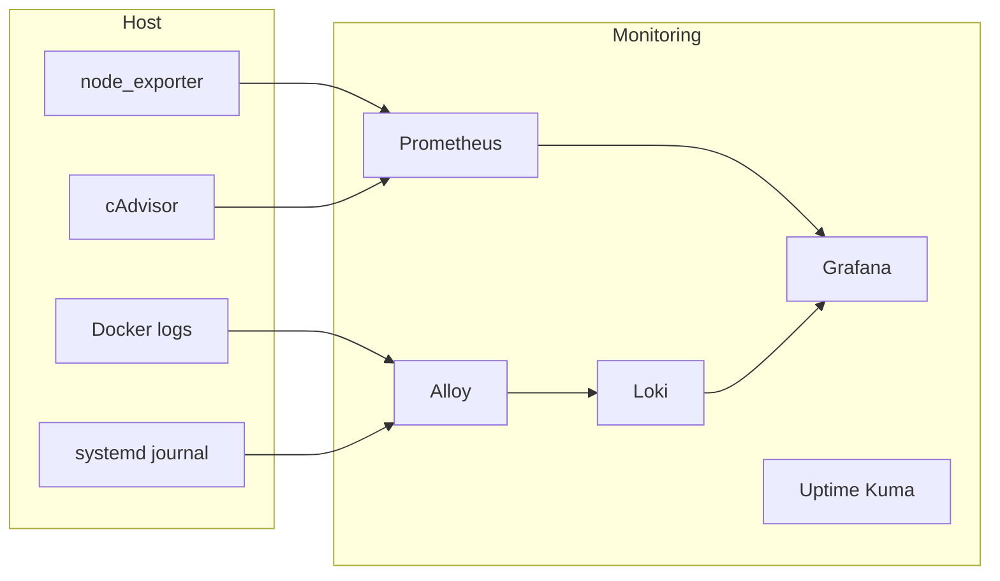
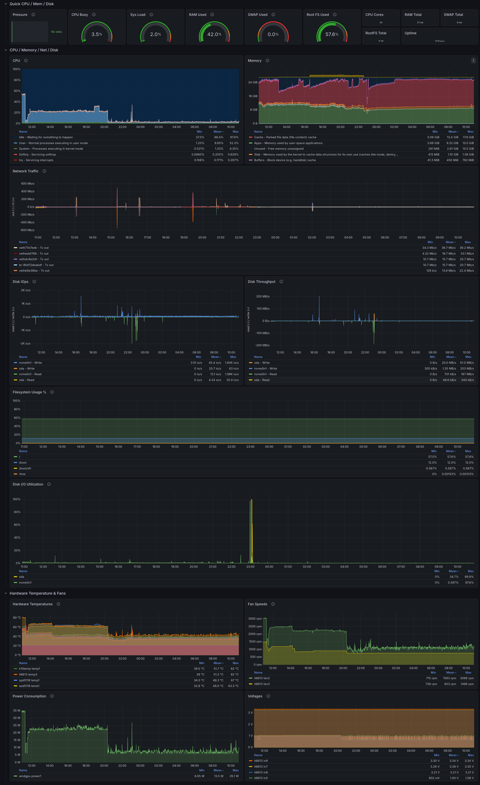
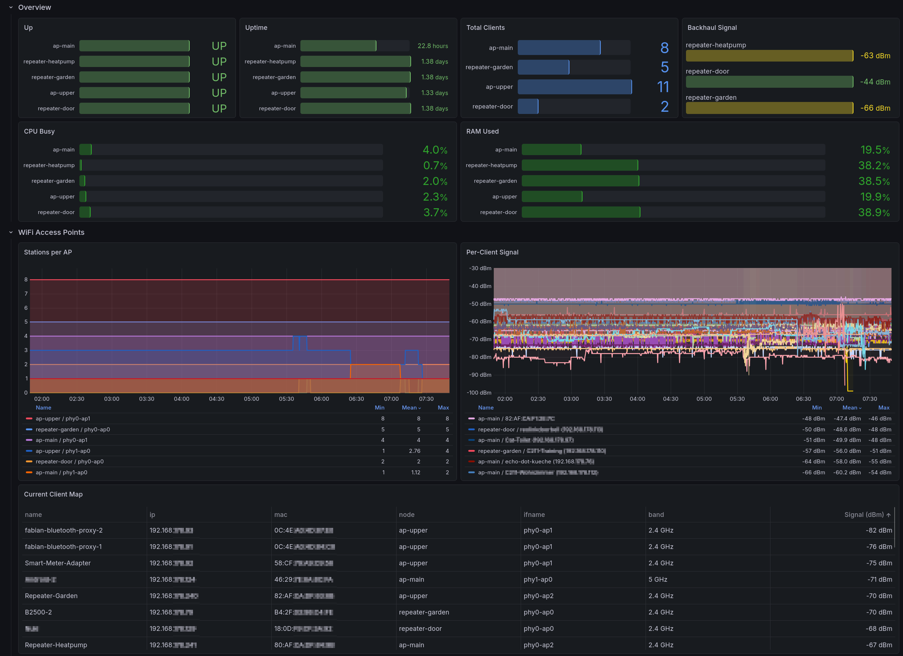

# Monitoring Stack

[](https://github.com/fabianwimberger/monitoring-stack/actions)
[](https://opensource.org/licenses/MIT)

A Docker Compose monitoring stack for self-hosted infrastructure. Metrics, logs, dashboards, and uptime monitoring in one command.

## Background

I kept setting up the same Prometheus, Grafana, and Loki combination on every
self-hosted box. This is that stack packaged as one command, with the pieces I
actually use: cAdvisor for container metrics, `node_exporter` on the hosts for
host metrics, Alloy for Docker and systemd-journal logs, Uptime Kuma for
endpoint checks, and Grafana with dashboards already wired up.

### Companion projects

This stack is the dashboard layer. Two of my other repos plug straight into it
as data sources:

| Repo | What it provides | How this stack uses it |
|---|---|---|
| [openwrt-only-home-network](https://github.com/fabianwimberger/openwrt-only-home-network) | Whole-home OpenWrt WiFi blueprint (wired APs + WDS repeaters) | Each node runs `node_exporter`; this stack scrapes them and visualizes them in the bundled OpenWrt WiFi dashboard |
| [fritzbox-monitoring](https://github.com/fabianwimberger/fritzbox-monitoring) | Prometheus exporter for AVM FritzBox cable modems (DOCSIS, speeds, ping) | Add its `:8000` target to `prometheus.yml` and use the bundled FritzBox dashboard |

Neither is required — the stack works standalone — but if you run them, the
integration is just a scrape-config edit.

## Features

- **Metrics** — Prometheus + cAdvisor, plus external `node_exporter` targets
- **Logs** — Loki + Grafana Alloy (Docker containers + systemd journal)
- **Dashboards** — Grafana with pre-provisioned dashboards for hosts, containers, logs, Traefik, OpenWrt WiFi, and FritzBox cable
- **Uptime** — Uptime Kuma for endpoint monitoring
- **Proxy overlay** — optional compose file that exposes only Grafana and Uptime Kuma through an existing reverse proxy
- **Network isolation** — Prometheus, Loki, Alloy, and cAdvisor stay on an internal network in proxy mode

## Quick Start

### Option 1: Local / LAN

For testing or running on your local network with direct port access:

```bash
git clone https://github.com/fabianwimberger/monitoring-stack.git
cd monitoring-stack

# Optional: edit settings
cp .env.example .env

# Start
make up
```

| Service | URL |
|---|---|
| Grafana | http://localhost:3000 |
| Prometheus | http://localhost:9090 |
| Uptime Kuma | http://localhost:3001 |

Default Grafana login: `admin` / `changeme` (set `GRAFANA_ADMIN_PASSWORD` in `.env` to change).

`make down`, `make restart` and `make logs` do what they say; `make clean` also deletes the data volumes. Proxy mode has `make down-proxy`.

### Option 2: Behind a Reverse Proxy

If you run [Traefik](https://traefik.io/) (or similar) already, use the proxy overlay:

```bash
cp .env.example .env
# Edit .env and set your domains:
#   GRAFANA_DOMAIN=grafana.example.com
#   UPTIME_KUMA_DOMAIN=uptime.example.com

make up-proxy
```

This exposes only Grafana and Uptime Kuma, on the `proxy` network. Prometheus, Loki, Alloy, and cAdvisor stay on the internal `monitoring` network with no published ports.

See `docker-compose.proxy.yml` if you use a different proxy — the labels are easy to adapt.

## How It Works



## Screenshots

<p align="center">
  
  <br><em>Host monitoring dashboard — CPU, memory, disk, network</em>
</p>

<p align="center">
  
  <br><em>OpenWrt WiFi dashboard — per-AP status, client counts, backhaul signal, CPU/RAM, stations per AP, per-client signal</em>
</p>

## Configuration

All settings are via `.env` (see [`.env.example`](.env.example)):

| Variable | Default | Description |
|---|---|---|
| `TZ` | `UTC` | Timezone for all services |
| `PROMETHEUS_PORT` | `9090` | Prometheus web UI port (local mode) |
| `PROMETHEUS_RETENTION` | `30d` | Metrics retention |
| `GRAFANA_PORT` | `3000` | Grafana web UI port (local mode) |
| `GRAFANA_ADMIN_PASSWORD` | `changeme` | Grafana admin password |
| `UPTIME_KUMA_PORT` | `3001` | Uptime Kuma web UI port (local mode) |
| `GRAFANA_DOMAIN` | — | Domain for Grafana (proxy mode) |
| `UPTIME_KUMA_DOMAIN` | — | Domain for Uptime Kuma (proxy mode) |
| `PROXY_NETWORK` | `proxy` | Name of your external Docker proxy network |

Metrics are retained for 30 days by default. Logs are retained for 14 days in
`config/loki.yml` because they usually use more disk space than metrics.

### Adding Hosts to Monitor

Edit `config/prometheus.yml` and add your `node_exporter` instances:

```yaml
scrape_configs:
  - job_name: "node"
    static_configs:
      - targets: ["192.168.1.10:9100", "192.168.1.11:9100"]
```

The bundled `dashboards/openwrt-wifi-network.json` expects an `openwrt` job
with a `node` label per device — see the commented template in
`config/prometheus.yml`.

### Adding Dashboards

Drop Grafana dashboard JSON files into `dashboards/`. They are auto-provisioned on startup.

### Backup and Restore

Data lives in named Docker volumes; [docs/backup.md](docs/backup.md) has the commands to archive and restore them.

## Requirements

- Docker and Docker Compose v2
- Linux host (for systemd journal and cAdvisor access)
- [node_exporter](https://github.com/prometheus/node_exporter) installed on hosts you want to monitor
- For proxy mode: an existing reverse proxy (Traefik, Nginx, Caddy, etc.)

## Security Notes

- **Alloy** runs with access to the Docker socket and systemd journal. The container uses `group_add` with `DOCKER_GID` (set in `.env`) so the process can access the Docker socket without full root privileges, and `cap_add: [DAC_READ_SEARCH]` helps with journal access. If you want to run fully unprivileged, set `DOCKER_GID` to your host's docker group ID and override the user in `docker-compose.yml`.
- **cAdvisor** runs `privileged: true` to read host hardware metrics. This is required by cAdvisor's design.
- All services include log rotation (`max-size: 10m`, `max-file: 3`) to prevent unbounded disk growth.

## License

[MIT](LICENSE)
